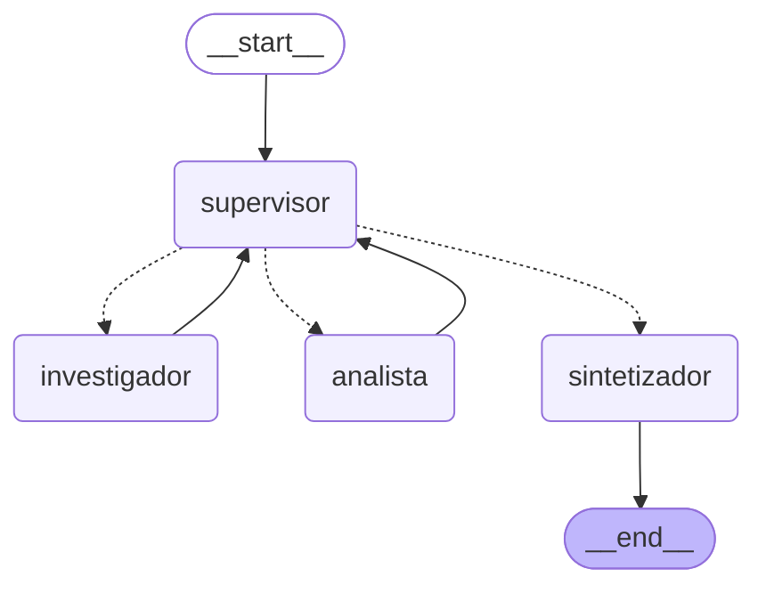

# Pre-entrega 6 · Orquestador multi-agente especializado

Prototipo de un **orquestador multi-agente de análisis e investigación** con LangGraph. Responde consultas sobre el ERP de OLA Muebles que necesitan dos especialidades distintas, **buscar reglas** en el manual técnico y **calcular** con esos datos, y cierra con una **síntesis final** validada por el supervisor.

> El manual del ERP es **ficticio**, creado para el curso. Es el mismo que se indexó en Pinecone en la [pre-entrega 4](../../unidad-04/pre-entrega-4).

## Diagrama del grafo



Lo genera `graph.get_graph().draw_mermaid()`; también está como imagen en [`grafo.png`](./grafo.png) y se regenera con `python main.py --diagrama`. Las líneas punteadas son las aristas condicionales que decide el supervisor.

## Estructura

| Archivo | Rol |
|---|---|
| [`state.py`](./state.py) | Estado compartido `OrchestratorState(MessagesState)`, con la pizarra de contribuciones y los campos de control (`next_agent`, `task_completed`, `delegaciones`…). |
| [`agents/supervisor.py`](./agents/supervisor.py) | **Supervisor:** router y controlador de flujo, con la rúbrica de validación y las salvaguardas de parada. `route_supervisor` devuelve un `Literal` con el nombre del nodo. |
| [`agents/research_agent.py`](./agents/research_agent.py) | **Investigador** (`create_react_agent`). Su herramienta es `buscar_manual`, que consulta Pinecone. |
| [`agents/analyst_agent.py`](./agents/analyst_agent.py) | **Analista** (`create_react_agent`). Sus herramientas son `calcular`, `dias_entre_fechas`, `sumar_dias` y `aplicar_porcentaje`. |
| [`agents/synthesizer.py`](./agents/synthesizer.py) | **Sintetizador:** redacta la respuesta final solo con las contribuciones. |
| [`graph.py`](./graph.py) | Arma el `StateGraph`: `add_node` para cada agente, aristas condicionales desde el supervisor y aristas de vuelta. |
| [`knowledge.py`](./knowledge.py) | Base de conocimiento. Puede ser Pinecone (pre-entrega 4) o BM25 local sobre los mismos archivos del manual. |
| [`runner.py`](./runner.py) / [`main.py`](./main.py) | Ejecución paso a paso con `astream` y guardado de la traza. |
| [`demo.ipynb`](./demo.ipynb) | **Notebook de demostración** del flujo de delegación. |
| [`tests/test_offline.py`](./tests/test_offline.py) | 11 tests sin API keys. Usan modelos "guionados" por rol con el grafo, el supervisor y las herramientas reales. |

## Por qué una topología jerárquica

- **Un solo punto de decisión.** Los especialistas no se hablan entre sí: cada uno hace su tarea y le devuelve el resultado al supervisor, que decide el siguiente paso. Así el flujo es fácil de seguir y de depurar, y la traza muestra quién decidió qué y por qué.
- **Especialistas con herramientas acotadas.** El investigador solo puede buscar y el analista solo puede calcular. Ninguno puede inventar el trabajo del otro: si el analista necesita un dato que no está, lo marca como faltante y el supervisor vuelve a mandar al investigador.
- **Validación centralizada.** La rúbrica vive en un único lugar, el prompt del supervisor, y se aplica antes de cerrar.
- **Escala bien.** Para sumar un especialista nuevo, por ejemplo uno de sentimiento o uno que valide esquemas, alcanza con agregar un nodo y una opción en el supervisor.

Una red en la que todos los agentes se hablan con todos sería más flexible, pero también más difícil de controlar y más propensa a bucles. Para un flujo de "investigar → calcular → sintetizar", la jerarquía alcanza y es más predecible.

## Estado compartido

```python
class OrchestratorState(MessagesState):
    contribuciones: Annotated[list[Contribucion], operator.add]  # quién aportó qué
    decisiones: Annotated[list[Decision], operator.add]          # qué decidió el supervisor y por qué
    next_agent: Literal["investigador", "analista", "sintetizador"]
    instruccion: str        # encargo concreto para el especialista que sigue
    delegaciones: int       # contador de pasos (condición de parada)
    task_completed: bool
    respuesta_final: str
```

Cada `Contribucion` registra `agente`, `ronda`, `instruccion`, `resultado`, `herramientas` usadas y `fuentes` consultadas. Como las listas usan el reducer `operator.add`, cada nodo devuelve solo lo nuevo y nada se pisa. Si un especialista refina su trabajo, la versión anterior queda en el historial con su número de ronda.

## Flujo de supervisión y validación

En cada ronda, el supervisor recibe la pregunta y la pizarra de contribuciones y responde un JSON con `siguiente`, `instruccion` y `motivo`. Antes de elegir `FINALIZAR` aplica esta **rúbrica**:

1. Cada regla de negocio la aportó el investigador **con su fuente**.
2. Cada número lo calculó el analista **con herramientas** a partir de esas reglas.
3. Están respondidas **todas** las partes de la pregunta.
4. No hay contradicciones ni datos marcados como "no encontrado" o "falta".

Si un criterio falla, devuelve el trabajo al especialista que corresponda con una instrucción concreta de qué corregir.

### Condición de parada (contra el "supervisor infinito")

Hay tres salvaguardas que no dependen del modelo:

| Salvaguarda | Valor | Qué hace |
|---|---|---|
| `MAX_DELEGACIONES` | 6 | Tope total de delegaciones. Al alcanzarlo, pasa directo al sintetizador. |
| `MAX_REVISIONES` | 2 | Un especialista puede rehacer su trabajo hasta 2 veces, o sea 3 intervenciones en total. |
| `recursion_limit` | 40 (grafo) / 12 (cada especialista) | Techo duro de LangGraph por si todo lo anterior falla. |

Si la respuesta del supervisor no es un JSON válido, se le pide que la corrija una vez. Si vuelve a fallar, una **regla determinista** decide: si falta la investigación va al investigador, si falta el análisis va al analista y, si ya están las dos, cierra. Cada decisión queda registrada con su `origen` (`llm` o `regla`).

### Cómo se manejan los conflictos entre agentes

- **Roles que no se pisan.** Las reglas solo las aporta el investigador y los números solo los calcula el analista. Si el analista recibe un dato dudoso, no lo inventa ni lo corrige: lo marca como faltante.
- **El supervisor arbitra.** Si dos aportes se contradicen, el criterio 4 de la rúbrica obliga a devolver el trabajo al especialista correspondiente con la discrepancia explicada.
- **La última versión gana, sin perder historia.** Cada contribución tiene su ronda. El sintetizador usa la más reciente de cada especialista, y la traza conserva todas.
- **Sin resolución, se declara.** Si se agotan las revisiones y el conflicto sigue, el sintetizador lo dice explícitamente en lugar de elegir un dato al azar.

### Contexto acotado (contra la contaminación de contexto)

Cada especialista corre su propio ciclo ReAct con **solo lo que necesita**:

- el **investigador** recibe el encargo del supervisor y la pregunta del usuario;
- el **analista** recibe el encargo, la pregunta y los hallazgos del investigador;
- ninguno ve el prompt del supervisor, las decisiones previas ni los mensajes internos de las herramientas del otro.

Esto se verifica en `test_contexto_acotado_por_especialista`.

## Cómo levantar el entorno

Requiere **Python 3.12+** y el índice de Pinecone de la pre-entrega 4 ya cargado.

```bash
cd unidad-06/pre-entrega-6
python -m venv .venv
.venv\Scripts\activate          # Windows  (en Linux/Mac: source .venv/bin/activate)
pip install -r requirements.txt
copy .env.example .env          # completá las keys de Anthropic, OpenAI y Pinecone
```

```bash
python main.py                                    # pregunta de demostración → trazas/traza_ejemplo.json y .log
python main.py "¿Qué rol puede cerrar la caja?"   # otra consulta
jupyter nbconvert --to notebook --execute --inplace demo.ipynb   # ejecuta el notebook y guarda las salidas
pytest -v                                         # tests offline (sin API keys)
```

Sin Pinecone, con `RESEARCH_BACKEND=local` el investigador busca con BM25 en los archivos del manual que están en `unidad-04/pre-entrega-4/data`.

## Demostración

La consulta de demostración obliga a pasar por los dos especialistas:

> Hoy es 10/11/2026. Un cliente pidió el 28/10/2026 un presupuesto por una biblioteca a medida de $1.180.000 y quiere confirmarlo con un 18 % de descuento. Según el manual del ERP: ¿el presupuesto sigue vigente?, ¿cuánto queda el precio con el descuento y cuánto tiene que pagar de seña?, ¿qué rol puede aprobar ese descuento?

Primero hay que **investigar** cuánto vale un presupuesto, qué seña llevan los muebles a medida y quién aprueba descuentos mayores al 15 %. Después hay que **calcular** los días transcurridos, el precio con descuento y el monto de la seña.

El notebook [`demo.ipynb`](./demo.ipynb) muestra la ejecución paso a paso. La traza completa queda en [`trazas/traza_ejemplo.json`](./trazas/traza_ejemplo.json) y [`.log`](./trazas/traza_ejemplo.log).

### Resultado de las corridas reales

Con Anthropic `claude-haiku-5-5` y el índice de Pinecone de la PE4:

**Corrida del notebook** ([`demo.ipynb`](./demo.ipynb), traza en [`trazas/traza_ejemplo.json`](./trazas/traza_ejemplo.json) y [`.log`](./trazas/traza_ejemplo.log)). Es el recorrido ideal, en 30,6 s:

`supervisor → investigador → supervisor → analista → supervisor → sintetizador → END`

| Ronda | Decide el supervisor | Qué aporta el especialista |
|---|---|---|
| 1 | investigador | 4 búsquedas (`buscar_manual`): validez de 15 días corridos y seña del 50 % [03-api-ventas.md]; descuentos de más del 15 % los aprueba `gerencia` [02-autenticacion-y-roles.md] |
| 2 | analista | `dias_entre_fechas`, `sumar_dias`, `aplicar_porcentaje` ×2 y `calcular`: 13 días, vence el 12/11/2026, $967.600 y seña de $483.800 |
| 3 | sintetizador | La rúbrica se cumple: respuesta final con las 3 partes y sus fuentes |

**Corrida por consola** (`python main.py`, traza en [`trazas/traza_refinamiento.log`](./trazas/traza_refinamiento.log)). Muestra la supervisión en acción:

- En la ronda 2, el supervisor **devuelve el trabajo al investigador** para que busque sobre qué monto se calcula la seña. El investigador confirma que el manual no lo define.
- El supervisor no vuelve a pedir esa búsqueda: le encarga al analista calcular **los dos escenarios**, $483.800 sobre el precio con descuento y $590.000 sobre el de lista.
- En la ronda 4, el supervisor **resuelve un conflicto**: el analista dijo que faltaba el rol aprobador, pero el supervisor verifica en la pizarra que el investigador ya lo había aportado con su fuente en la ronda 1, y cierra.

**Una corrida anterior** reveló un bug: la herramienta recortaba cada fragmento a 900 caracteres y las reglas de la seña y de los descuentos quedaban afuera. El orquestador reaccionó bien: el analista marcó los datos faltantes en vez de inventarlos, y el tope de revisiones cortó el ciclo. Se corrigió y se agregó un test de regresión (`test_busqueda_no_recorta_reglas_al_final_del_fragmento`).
