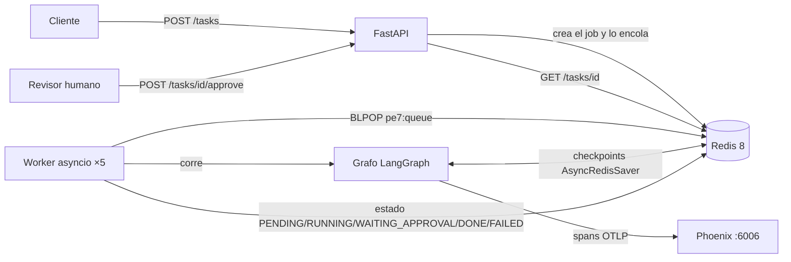
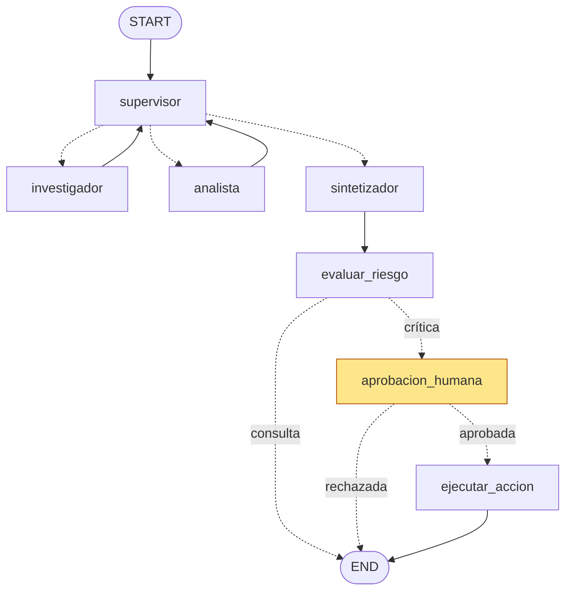

# Pre-entrega 7 · API de producción y monitoreo activo

Esta entrega expone por **API REST** el orquestador multi-agente de la [pre-entrega 6](../../unidad-06/pre-entrega-6): un supervisor coordina a un investigador, que busca en el Pinecone de la PE4, y a un analista, que hace los cálculos. Suma cuatro capacidades:

- **Endpoints asíncronos:** `POST /tasks` encola la tarea y devuelve un `job_id` al instante. Un worker en segundo plano corre el grafo.
- **Redis:** guarda el estado de cada job, la cola de trabajo y los **checkpoints de LangGraph** (`AsyncRedisSaver`).
- **Observabilidad con Arize Phoenix:** cada ejecución manda su traza completa (nodos, llamadas al LLM con tokens, herramientas y búsquedas en Pinecone) vía OpenTelemetry/OpenInference. Phoenix calcula el costo y la latencia p95.
- **Human-in-the-loop:** si la tarea pide **ejecutar** una acción en el ERP ("aplicá el descuento", "registralo", "anulá la venta"), el grafo se pausa con `interrupt()` hasta que una persona la apruebe por `POST /tasks/{id}/approve`.

## Arquitectura



### El grafo, con la pausa humana



| Archivo | Rol |
|---|---|
| [`app/main.py`](./app/main.py) | FastAPI: `POST /tasks`, `GET /tasks/{id}` y `GET /health`. Solo hace operaciones async contra Redis y nunca llama al LLM. |
| [`app/worker.py`](./app/worker.py) | Worker: consume la cola, corre o reanuda el grafo y escribe el estado. **Cualquier excepción deja el job en `FAILED`.** |
| [`app/graph.py`](./app/graph.py) | El orquestador de la PE6 más los nodos HITL, compilado con `AsyncRedisSaver`. |
| [`app/hitl.py`](./app/hitl.py) | Detección de tareas críticas, nodo `aprobacion_humana` (`interrupt`), nodo `ejecutar_accion` y endpoint `POST /tasks/{id}/approve`. |
| [`app/observability.py`](./app/observability.py) | `register()` de Phoenix, `LangChainInstrumentor`, la traza raíz por job (sesión = `job_id`) y el decorador `@observar`. |
| [`app/jobs.py`](./app/jobs.py) | Estado de los jobs, cola y "ERP" simulado en Redis. |
| `app/agents/`, `app/state.py`, `app/knowledge.py` | Supervisor, investigador, analista y sintetizador de la PE6; estado compartido y base de conocimiento. |
| [`scripts/carga.py`](./scripts/carga.py) | Prueba de carga: 5 peticiones concurrentes. |
| [`tests/test_api.py`](./tests/test_api.py) | 14 tests sin keys ni servicios: API, cola, worker, HITL, `FAILED` y concurrencia. |

## Cómo cumple cada punto

### 1. Endpoints asíncronos que no bloquean

- `POST /tasks` crea el job en Redis, lo encola (`RPUSH`) y responde **202** con el `job_id`, sin esperar al agente. El test `test_post_encola_y_responde_sin_esperar_al_agente` verifica que responda en menos de 0,3 s aunque cada llamada al LLM tarde 0,5 s.
- Todos los endpoints son `async def` y usan `redis.asyncio`. Ninguno llama al LLM ni hace I/O bloqueante, así que el event loop queda libre.
- El **worker** corre como 5 tareas asyncio en el mismo proceso (`WORKER_CONCURRENCY=5`). Si se quiere escalar, también puede correr aparte con `python -m app.worker`, en uno o más procesos. Como la cola vive en Redis, la API y los workers no comparten memoria.

### 2. Estado en Redis

| Clave | Contenido |
|---|---|
| `pe7:job:{id}` | Hash con `status`, `pregunta`, `resultado`, `error`, `aprobacion_pendiente` y timestamps. Vence a los 7 días. |
| `pe7:job:{id}:eventos` | Historial de transiciones, por ejemplo `PENDING → RUNNING → WAITING_APPROVAL → PENDING → RUNNING → DONE`. |
| `pe7:queue` | Cola de trabajo (`RPUSH` / `BLPOP`). |
| `checkpoint:*` | Checkpoints de LangGraph (`AsyncRedisSaver`, con `thread_id = job_id`). Es lo que permite pausar en el HITL y reanudar, incluso si se reinicia la API. |
| `erp:acciones` | El "ERP" simulado: las acciones ejecutadas tras una aprobación humana. |

**Manejo de errores:** el worker envuelve cada ejecución en un `try/except`. Si el agente falla, por ejemplo porque el LLM no responde o Pinecone se cae, el job pasa a `FAILED` con el error, en lugar de quedar en `RUNNING` para siempre. Lo verifica `test_excepcion_en_el_agente_deja_el_job_en_failed`.

### 3. Observabilidad (Arize Phoenix)

- `register()` de `phoenix.otel` exporta los spans por OTLP a Phoenix, y `LangChainInstrumentor` (OpenInference) instrumenta LangChain y LangGraph. Así, **cada nodo del grafo, cada llamada al LLM (con tokens de entrada y salida) y cada herramienta** quedan como spans.
- Cada ejecución de un job abre una traza raíz `job.start` o `job.resume`, agrupada en la misma **sesión** (`session.id = job_id`). La ejecución inicial y la reanudación después de la aprobación se ven juntas.
- `@observar(...)` decora funciones propias que no son Runnables de LangChain, como `pinecone.similarity_search`, que aparece como span `RETRIEVER` con su consulta y los fragmentos devueltos.
- **Costo:** Phoenix lo calcula solo, multiplicando los tokens de cada llamada por el precio de `claude-haiku-5-5`, que ya viene en su tabla de precios.

### 4. Human-in-the-loop

- `evaluar_riesgo` decide con **reglas, no con el LLM**, si la tarea es crítica: es crítica cuando pide ejecutar algo en el ERP con un verbo en imperativo (aplicá, registrá, anulá, emití, facturá, confirmalo…). Una compuerta de seguridad no debería depender de que el modelo la respete.
- Si es crítica, el nodo `aprobacion_humana` llama a `interrupt()`. LangGraph guarda el estado en Redis, el job queda en **`WAITING_APPROVAL`** con la acción propuesta y **nada toca el ERP**.
- `POST /tasks/{id}/approve` con `{"aprobado": true|false, "revisor", "comentario"}` reencola el job. El worker reanuda con `Command(resume=decisión)`:
  - si se aprobó, `ejecutar_accion` registra la acción en `erp:acciones`;
  - si se rechazó, termina sin efectos secundarios.
- Las consultas de solo lectura, como "¿sigue vigente?" o "¿qué rol puede aprobar?", no se pausan.

## Cómo levantarlo

Requiere **Docker Desktop**. Para correrlo sin Docker hace falta Python 3.12+ y un Redis 8.

```bash
cd unidad-07/pre-entrega-7
copy .env.example .env          # completá las keys de Anthropic, OpenAI y Pinecone
docker compose up --build       # levanta Redis 8, Phoenix y la API
```

- API y documentación interactiva: http://localhost:8000/docs
- Phoenix: http://localhost:6006 (proyecto `ola-erp-orquestador`)

**Sin Docker para la API** (Redis y Phoenix siguen en Docker):

```bash
docker compose up -d redis phoenix
python -m venv .venv && .venv\Scripts\activate && pip install -r requirements.txt
uvicorn app.main:app
```

### Probar un job a mano

En http://localhost:8000/docs (Swagger):

1. `POST /tasks` con `{"pregunta": "Aplicá un 18 % de descuento al presupuesto P-1042 y registralo en el ERP"}` devuelve un `job_id`.
2. `GET /tasks/{job_id}` pasa por `RUNNING` y llega a `WAITING_APPROVAL`, con la `accion_propuesta`.
3. `POST /tasks/{job_id}/approve` con `{"aprobado": true, "revisor": "gerencia"}` deja el job en `DONE`, con `accion_resultado` registrado en el ERP.

### Prueba de carga: 5 peticiones concurrentes

Con la API levantada, desde otra terminal (solo necesita `httpx`):

```bash
pip install httpx
python scripts/carga.py --aprobar
```

Manda las 5 preguntas a la vez: cuatro consultas y una tarea crítica, que el script aprueba como "gerencia" cuando queda en `WAITING_APPROVAL`. Imprime el estado y la latencia de cada job y guarda `resultados_carga.json`. Después, en Phoenix se leen el **costo por ejecución** y la **latencia p95** de esa corrida.

### Tests (sin keys ni servicios)

```bash
pytest -v
```

## Resultados y capturas

*Se completa con la corrida real.*
